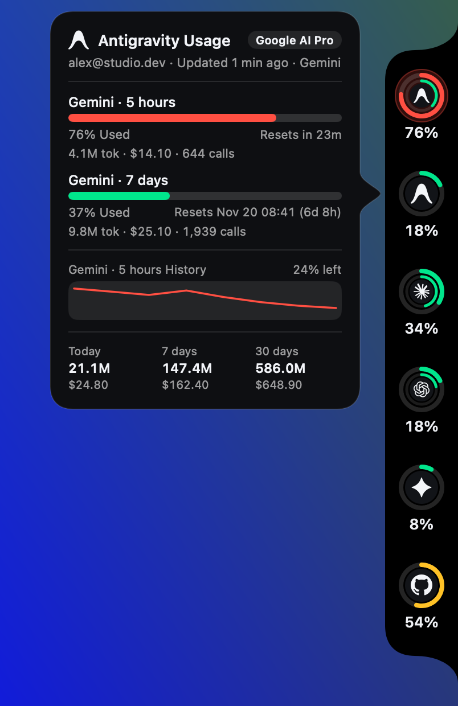
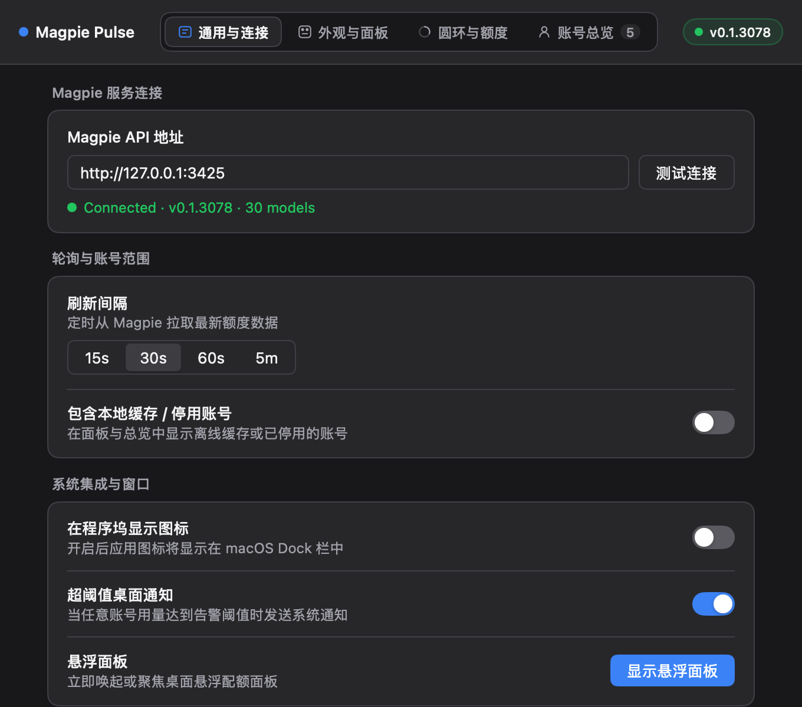
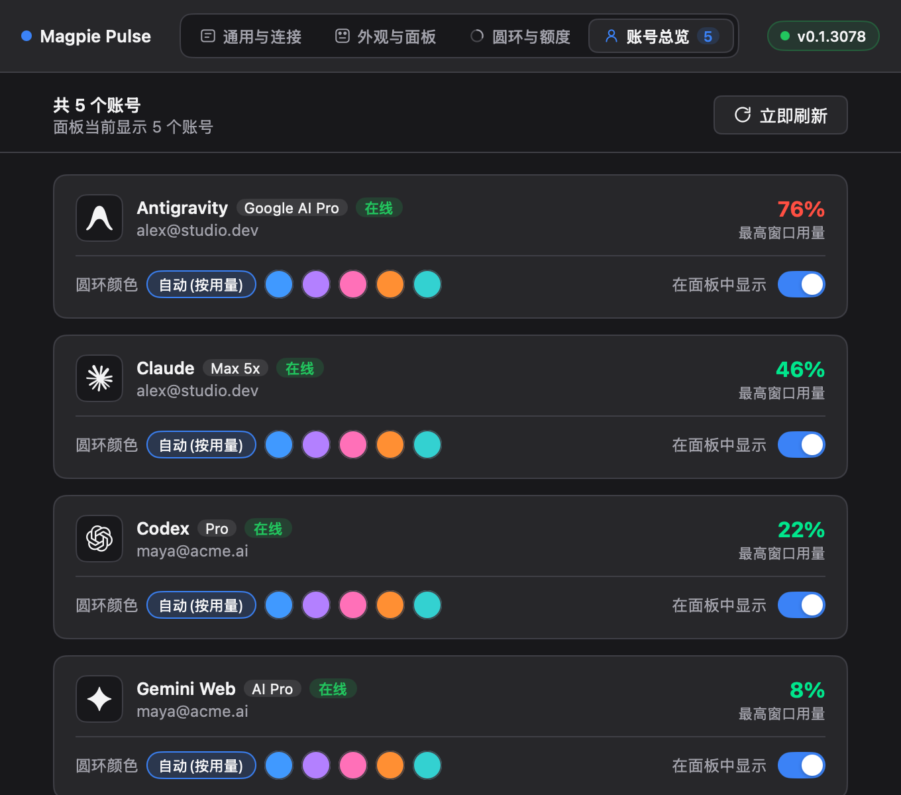

# Magpie Pulse

A lightweight, native macOS desktop quota monitor for **Magpie**, built with [MyGo](https://github.com/egoist/mygo) and inspired by the floating rail UI of [Pulse](https://github.com/qunqin24/Pulse).

Magpie Pulse docks cleanly along any edge of your screen (or floats anywhere), tracks multi-provider subscription quotas in real time, and supports one-click signed updates straight from GitHub Releases.

<p align="center">
  
</p>

## Features

- **Pulse-Inspired Floating Rail & Flyout Card**
  - Dock to the **Right / Left / Top / Bottom** screen edge or use **Floating** mode.
  - **Dark**, **Light**, and **Liquid Glass** surfaces with adjustable glass transparency, round/flat ends, compact/standard/large sizing, and optional edge auto-collapse.
  - Hover or click any slot to open its detail card with window progress bars (continuous capsule or segmented ticks), reset countdowns, token/cost breakdown, history sparkline, and Today / 7d / 30d usage totals.
- **Unified Short & Long Cycle Logic**
  - **Outer ring** always represents the **shorter cycle** (e.g., `5 hours`, `24 hours`).
  - **Inner ring** represents the **longer cycle** (e.g., `7 days`).
  - **Detail card** lists short-cycle windows on top and long-cycle windows below.
  - Optional outer **reset clock arc** visualizes elapsed time in the active reset window.
- **Multi-Provider & Pool Support**
  - Supports Antigravity (with optional multi-pool splitting), Claude, Codex, Gemini Web, Google AI Studio, GitHub Copilot, Kiro, ZCode, and offline/cached account fallback.
  - Per-account visibility switches and custom ring tint presets.
- **Native Settings & System Tray**
  - Native macOS window with centered titlebar pill tabs, live Magpie connection testing, polling interval selector (`15s` / `30s` / `60s` / `5m`), threshold alerts, and menu bar tray controls.
- **Signed Auto-Updates via GitHub Releases**
  - Integrated with MyGo's native updater (`updater/native`) and Ed25519 signature verification.
  - Automatically checks for updates on launch / daily, or manually via **Settings → 检查更新** or the tray menu (**Check for Updates…**), and installs updates directly.

## Screenshots

| General & Updates | Appearance & Panel | Accounts Overview |
| :---: | :---: | :---: |
|  |  |  |

## Installation

1. Download the latest macOS `.dmg` for your architecture from [GitHub Releases](https://github.com/jae-jae/magpie-pulse/releases):
   - Apple Silicon: `magpie-pulse-<version>-arm64.dmg`
   - Intel Mac: `magpie-pulse-<version>-amd64.dmg`
2. Drag **Magpie Pulse.app** into `/Applications` and launch it.
3. Ensure **Magpie** is running locally (default endpoint `http://127.0.0.1:3425`, configurable in **Settings → 通用与连接**).

## Development

### Prerequisites

- Go `1.27.3+` (`CGO_ENABLED=0` — MyGo compiles pure Go with no cgo)
- macOS for building `.app` / `.dmg` bundles locally

### Common Commands

```bash
# Run all unit, UI, and headless E2E tests
CGO_ENABLED=0 go test -race ./...

# Run MyGo static checks
CGO_ENABLED=0 go tool mygo vet .

# Run in development mode
CGO_ENABLED=0 go tool mygo dev

# Build macOS app & dmg locally
CGO_ENABLED=0 go tool mygo build -platform darwin/arm64
```

## Automated CI & Release Pipeline

Every push to `main` triggers [`.github/workflows/release.yml`](.github/workflows/release.yml):

1. **Prepare**: Checks `mygo.json` version; if `v<version>` already exists as a tag or release, bumps the patch version automatically, commits `chore(release): v<next> [skip ci]`, pushes the tag, and creates a draft GitHub Release.
2. **Build (`macos-latest`)**: Runs `go test ./...` and `go tool mygo vet .`, then builds and signs `darwin/arm64` and `darwin/amd64` `.dmg`, `.tar.gz`, `SHA256SUMS`, and `update-darwin-*.json` manifests via `go tool mygo build -upload` using `MYGO_UPDATER_PRIVATE_KEY`.
3. **Publish**: Marks the GitHub Release as published and `latest`.
